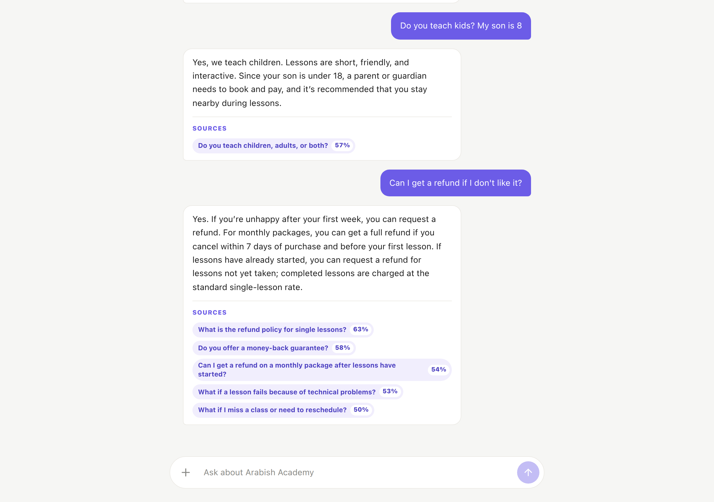
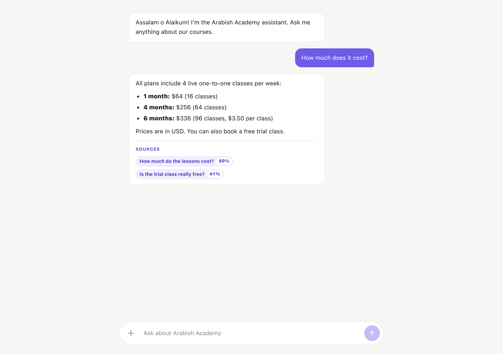
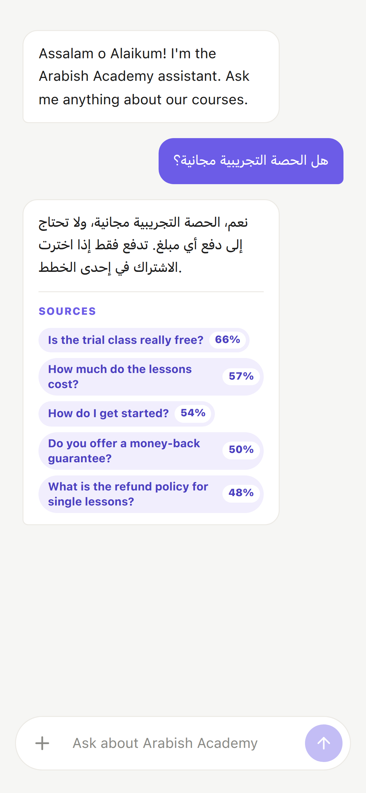

# Arabish Academy AI Assistant

A support chatbot for [Arabish Academy](https://thearabish.com/), an online academy that teaches Arabic and English.
Students can ask about courses, prices, refunds or anything else, and the bot answers **only from the academy's real FAQ**, so it doesn't make things up.

**Live demo:** https://arabish-ai-assistant.vercel.app



## What it does

- Answers questions about the academy from a list of 44 FAQs (taken from the academy website)
- Shows the **sources** it used for each answer, with a match score
- Remembers the conversation, so follow-up questions work
- Replies in the user's language (English, Arabic, ...)
- Politely says "I don't know" when the answer isn't in the FAQ
- Works on phone and desktop

| Pricing question | Arabic question on mobile |
| --- | --- |
|  |  |

## How it works

This is a **RAG** (Retrieval-Augmented Generation) app with a simple **agent**:

1. The user sends a message from the React app.
2. The Express server sends it to the OpenAI model with one tool: `search_faq`.
3. If the question is about the academy, the model calls `search_faq`.
4. `search_faq` turns the question into a vector and finds the closest FAQs in **Pinecone** (vector database).
5. The model writes a short answer using only those FAQs.
6. The server sends back the answer + sources to the UI.

Small talk like "hi" is answered directly, without searching.

## Tech stack

| Part | Tools |
| --- | --- |
| Frontend | React 19, Vite, Tailwind CSS, react-markdown, Lucide icons |
| Backend | Node.js, Express 5, TypeScript |
| AI | OpenAI Responses API (tool calling), OpenAI embeddings |
| Database | Pinecone (vector search) |
| Hosting | Vercel |

## Project structure

```
client/                  React app
  src/App.jsx            chat state and API call
  src/components/        ChatMessage, ChatInput, MarkdownText
server/                  Express API
  src/server.ts          app setup
  src/routes/chat.ts     POST /api/chat (input checks)
  src/services/chat.ts   the agent loop (model + tool calls)
  src/services/retrieval.ts   Pinecone search
  data/faq.json          the FAQ data
  scripts/               create index, load FAQs, test keys
```

## Run it locally

You need Node.js 20+, an OpenAI API key and a Pinecone API key.

**1. Server**

```bash
cd server
npm install
cp .env.example .env      # add your keys
npm run create-index      # only the first time, then copy the host into .env
npm run ingest            # load the FAQs into Pinecone
npm run dev               # http://localhost:3000
```

**2. Client** (in a second terminal)

```bash
cd client
npm install
npm run dev               # http://localhost:5173
```

## Deployment

The app is one Vercel project with `server/` as the root folder.
`npm run build` builds the React app into `server/public`, and Express serves it together with the `/api` routes, so everything runs on one URL.
Every push to `main` deploys automatically.

## API

`POST /api/chat`

```json
{ "message": "How much does it cost?", "previousResponseId": "optional" }
```

Response:

```json
{
  "answer": "All plans include 4 live one-to-one classes per week...",
  "responseId": "resp_...",
  "usedTools": true,
  "sources": [{ "question": "How much do the lessons cost?", "score": 0.5 }]
}
```

## What I learned

- How RAG works: embeddings, vector search and a similarity threshold
- How to let a model call my own function (tool calling) and loop until it has an answer
- Search quality matters: at first the bot couldn't find prices because the search query had the academy name in it, so every result matched "Arabish Academy" instead of "price". Removing the name from the query fixed it.
- Validating input on the server and showing clear errors in the UI

## Author

**Asif Shahzad** · [GitHub](https://github.com/asifthedev)
